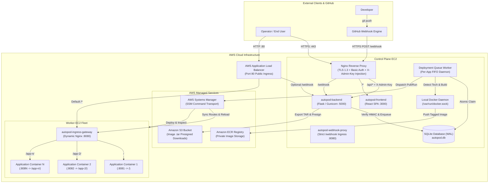
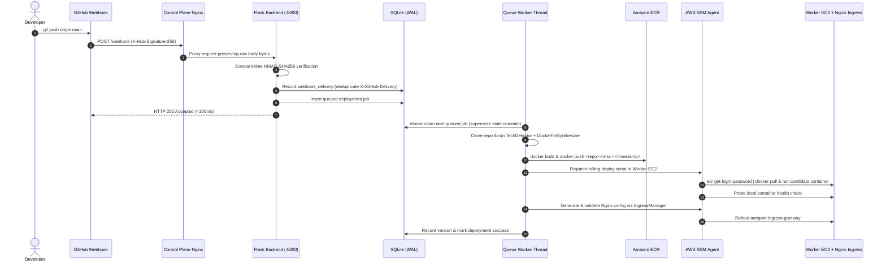

# AutoPod Cloud — System Architecture Specification

**Version:** 3.0 (Production Release)  
**Platform:** Self-Hosted Multi-Application CI/CD & Container Orchestration Platform (PaaS)  
**Target Environment:** AWS Cloud (`us-east-1`) / Docker Engine  

---

## 1. System Overview

**AutoPod Cloud** provides an automated, self-hosted container deployment platform combining push-to-deploy CI/CD pipelines, multi-application L7 ingress routing, remote worker orchestration over AWS Systems Manager (SSM), and a real-time React management dashboard.

```text
GitHub → Webhook (HTTPS / HMAC-SHA256) → AutoPod Control Plane
    → Atomic Deployment Queue → Docker Build (Universal Runtime Detection)
    → AWS ECR → SSM Rolling Deploy → Worker EC2
    → Nginx Ingress Gateway (Path Multiplexing + Relative 301 Redirects)
    → AWS ALB → Public Application
```

### Core Architectural Properties
- **Control Plane / Worker Separation:** Management APIs, SQLite metadata store, React SPA, and Docker image build workflows run on the Control Plane host; user application containers and the Nginx Ingress Gateway run isolated on the Worker EC2 fleet.
- **Zero-SSH Remote Execution:** Remote container deployments, lifecycle controls, health probes, and Nginx reloads are dispatched via AWS Systems Manager (`SSM:SendCommand`) over IAM instance profiles with zero public SSH exposure required for CI/CD.
- **Asynchronous Atomic Deployment Queue:** Incoming GitHub webhooks return `HTTP 202 Accepted` in `<100ms` after cryptographic validation and enqueueing; background daemon workers atomically claim jobs in single-transaction SQLite updates (`claim_next_queued_deployment`) to prevent multi-worker Gunicorn race conditions.
- **Non-Breaking Rolling Swaps & Rollbacks:** Candidate containers start cleanly alongside or replace safely after passing HTTP health verification ([`health_probe.py`](health_probe.py)). Rollbacks re-deploy immutable ECR image tags (`<app>:<commit>-<timestamp>`) without re-cloning source code.

---

## 2. End-to-End Topology Diagram



---

## 3. Request & Deployment Flows

### 3.1 Webhook Push-to-Deploy Sequence



### 3.2 L7 Public Application Routing (`IngressManager`)

Each deployed application is registered with a public route prefix (`/` for the primary root workload, or `/<app-slug>/` for co-located subpath workloads).

- **Path Normalization & Relative Redirects:** Requests to `/<app-slug>` without a trailing slash receive an explicit `HTTP 301 Moved Permanently` with a relative `Location: /<app-slug>/;` directive (`absolute_redirect off;`), preserving the public ALB hostname without ever exposing internal EC2 IPs or worker ports (`127.0.0.1:8080`).
- **Prefix Stripping & Header Forwarding:** Nginx rewrites `/<app-slug>/(.*)` to `/$1` upstream while injecting `Host`, `X-Real-IP`, `X-Forwarded-For`, `X-Forwarded-Proto`, and WebSocket upgrade headers.
- **Health Check Probes:** `/healthz` returns static `HTTP 200 OK` on port `8080` for AWS ALB Target Group health probes (`autopod-worker-ingress-tg`).

---

## 4. Data Model (SQLite WAL Schema)

State persistence is managed in [`database.py`](database.py) using SQLite in Write-Ahead Logging (`WAL`) mode with row-level helpers:

| Table | Purpose |
| :--- | :--- |
| `applications` | Registered GitHub repositories, container naming, worker target port, ingress `routing_path`, `public_url`, `health_check_path`, and `lifecycle_status` (`active` / `removed`). |
| `versions` | Immutable history of built image tags (`<image>:<sha>-<ts>`), git commit SHAs, active pointers (`is_current`), and deployment metadata. |
| `deployments` | Complete audit trail of every rollout (`in_progress`, `success`, `failed`), duration, build logs, commit metadata, and rollback lineage. |
| `deployment_queue` | Asynchronous job queue supporting atomic worker claims (`queued` -> `processing` -> `completed`/`superseded`/`failed`). |
| `webhook_deliveries` | Idempotency table keyed on `X-GitHub-Delivery` UUIDs to prevent duplicate builds on webhook retries. |
| `app_nodes` | Registered worker EC2 hosts synchronized manually or from an AWS Auto Scaling Group ([`aws_nodes.py`](aws_nodes.py)). |
| `containers` | Cached container telemetry snapshot synchronized with live Control Plane and Worker Docker engines. |
| `logs` | Structured platform operational events, container actions, and error traces. |

---

## 5. Security Architecture

AutoPod Cloud strictly separates three distinct authentication boundaries:

1. **GitHub Webhook Boundary (`/webhook`):**
   - Verified via HMAC-SHA256 (`hmac.compare_digest`) over raw HTTP request bytes using `GITHUB_WEBHOOK_SECRET`.
   - Unsigned or invalid signatures receive `HTTP 401 Unauthorized` immediately.
2. **Dashboard User Boundary (Control Plane Nginx TLS :443):**
   - Protected by HTTP Basic Authentication (`/etc/nginx/.htpasswd`) over TLS 1.2 / 1.3.
   - Upon authenticating dashboard requests to `/api/*`, Nginx injects the internal `X-Admin-Key` upstream so **client browsers never receive or store administrative API credentials**.
3. **Backend Admin API Boundary (`@require_admin_key` on `:5000`):**
   - All mutating endpoints (`/api/containers/*`, `/api/deployments*`, `/api/applications*`, `/api/images/*`, `/api/sync`) validate `X-Admin-Key` via [`auth.py`](auth.py). Direct unauthenticated requests to port `5000` return `HTTP 401 Unauthorized`.
4. **Infrastructure Protection Safeguards:**
   - Core platform containers (`autopod-frontend`, `autopod-backend`, `autopod-webhook-proxy`) are permanently locked against deletion (`HTTP 403 Forbidden` in API and disabled UI controls).
5. **AWS Least-Privilege IAM:**
   - EC2 instances authenticate against ECR, S3, and SSM natively via IAM Instance Profiles — no static `AWS_ACCESS_KEY_ID` or `AWS_SECRET_ACCESS_KEY` tokens are stored on hosts or in `.env`.
