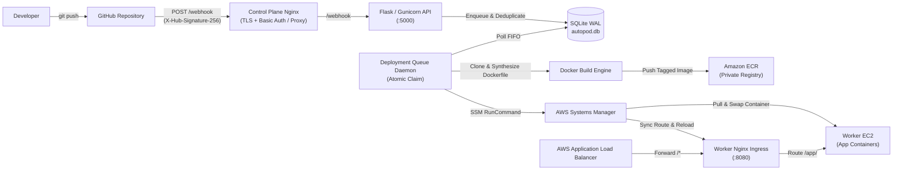

# 🚀 AutoPod Cloud


**AutoPod Cloud** is a self-hosted, multi-application CI/CD and container orchestration platform engineered on AWS infrastructure. Push code to GitHub, and AutoPod validates the webhook signature, queues an asynchronous build, detects the application runtime stack, builds a Docker image, pushes it to Amazon ECR, rolls it out zero-downtime to Worker EC2 nodes via AWS Systems Manager (SSM), updates the L7 Nginx Ingress Gateway, and serves live traffic through an AWS Application Load Balancer — complete with real-time dashboard monitoring, instant version rollbacks, and S3 Docker image `.tar` archive exports.

---

## Verified End-to-End Architecture

```text
GitHub → Webhook (HTTPS / HMAC-SHA256) → AutoPod Control Plane
    → Atomic Deployment Queue → Docker Build (Universal Runtime Detection)
    → AWS ECR → SSM Rolling Deploy → Worker EC2
    → Nginx Ingress Gateway (Path Multiplexing + Relative 301 Redirects)
    → AWS ALB → Public Application
```



---

## Core Capabilities

- **Asynchronous GitHub Push-to-Deploy:** HMAC-SHA256 signature verification (`X-Hub-Signature-256`), delivery ID deduplication, and atomic SQLite queue claiming (`HTTP 202 Accepted` response in `<100ms`).
- **Universal Technology Detection & Dockerfile Synthesis:** Supports custom `Dockerfile` / `Containerfile`, Static HTML/CSS/JS, React (Vite & Create React App), Node.js / Express, Python Flask, and Python FastAPI ([`tech_detector.py`](tech_detector.py), [`dockerfile_synthesizer.py`](dockerfile_synthesizer.py)).
- **Safe Rolling Deployments & Zero-Downtime Rollbacks:** Candidate containers are started and HTTP health-checked before traffic cutover ([`health_probe.py`](health_probe.py)). One-click version rollbacks redeploy historical ECR tags directly without rebuilding source code.
- **Multi-Application Path Ingress:** Shared Worker Nginx Ingress Gateway ([`ingress_manager.py`](ingress_manager.py)) dynamically multiplexes path routes (`/`, `/voltride-electric-mobility-companion/`, `/crypto-price-analysis-dashboard/`) with sanitized relative `301` redirects (never exposing internal localhost or ports).
- **Zero-SSH Worker Orchestration:** Dispatches container deployments, restarts, stops, starts, log queries, and ingress reloads over encrypted **AWS Systems Manager (SSM)** sessions ([`node_deployer.py`](node_deployer.py), [`docker_manager.py`](docker_manager.py)), with restricted SSH supported as fallback.
- **On-Demand S3 Image Export:** Exports running container images via `docker save` to Amazon S3 and generates 15-minute AWS SigV4 presigned download URLs directly from the dashboard.
- **Hardened Security Model:** Strict separation between GitHub webhook secrets, Nginx HTTP Basic Auth, and the backend `X-Admin-Key` (injected server-side by Nginx reverse proxy so client browsers never store administrative keys). Protected infrastructure safeguards block accidental deletion of platform containers (`autopod-backend`, `autopod-frontend`, `autopod-webhook-proxy`).

---

## Technology Stack

| Layer | Actual Technologies Used |
| :--- | :--- |
| **Control Plane API** | Python 3.9+, Flask 2.3, Gunicorn 21.2, Flask-CORS, Werkzeug ProxyFix |
| **Database & Queue** | SQLite 3 (WAL mode, single-transaction atomic job claiming) + background thread worker |
| **Frontend Dashboard** | React 19, React Router DOM 7, Axios, Lucide React Icons, Create React App 5, Nginx |
| **Container Engine** | Docker Engine CLI (`docker` daemon socket + remote worker execution via SSM) |
| **AWS Infrastructure** | VPC, Public Subnets, Security Groups, EC2, Auto Scaling Group, ALB, ECR, S3, SSM, IAM, CloudWatch |
| **IaC & Config Mgmt** | Terraform (HCL), Ansible (Docker, Deployment, Monitoring/Prometheus/Grafana roles), Certbot / TLS |
| **Testing** | Pytest (`218 passed, 41 skipped` offline), Jest / React Testing Library (`15 passed`) |

---

## Repository Structure

```text
autopod/
├── app.py                        # Flask API server, CORS, ProxyFix, REST & SSE endpoints
├── auth.py                       # X-Admin-Key validation middleware
├── aws_nodes.py                  # EC2 Auto Scaling Group instance discovery (boto3)
├── database.py                   # SQLite schema, CRUD helpers & atomic deployment claiming
├── deployment_engine.py          # 12-stage CI/CD pipeline orchestrator
├── deployment_queue.py           # Asynchronous FIFO queue daemon & commit superseding
├── docker_manager.py             # Control plane & SSM worker Docker lifecycle + S3 export
├── dockerfile_synthesizer.py     # Deterministic Dockerfile & Nginx config generator
├── health_probe.py               # HTTP health probe for candidate containers
├── ingress_manager.py            # Worker Nginx Ingress Gateway dynamic config & safe reload
├── node_deployer.py              # SSM & SSH rolling deployment engine across worker fleet
├── tech_detector.py              # Repository framework & runtime detector
├── version_manager.py            # Commit+timestamp image tagging & active version pointers
├── webhook_handler.py            # GitHub push event parser & HMAC-SHA256 verifier
├── Dockerfile                    # Control plane backend image
├── docker-compose.yml            # Multi-container orchestration (backend, frontend, webhook proxy)
├── requirements.txt              # Python dependencies
├── .env.example                  # Documented environment variable template (placeholders only)
├── ARCHITECTURE.md               # Complete system architecture & data flows
├── docs/
│   ├── BACKEND.md                # Backend modules, API routes & queue mechanics
│   ├── FRONTEND.md               # React SPA pages, security model & UI workflows
│   ├── INFRASTRUCTURE.md         # AWS topology, Terraform, Ansible & Nginx routing
│   ├── DEPLOYMENT_AND_WEBHOOKS.md# Docker setup, GitHub webhooks, env vars, tests & limitations
│   └── OPERATOR_GUIDE.md         # Sanitized day-2 operational runbook
├── frontend/                     # React dashboard application
│   ├── Dockerfile
│   ├── nginx.conf
│   ├── package.json
│   └── src/                      # Pages, components, services/api.js, styles, tests
├── infra/                        # Infrastructure as Code & reverse proxy configs
│   ├── docker-compose.prod.yml
│   ├── ec2-setup.sh
│   ├── nginx/                    # Control plane HTTPS proxy & isolated webhook proxy configs
│   ├── terraform/                # AWS VPC, ALB, EC2, ASG, ECR, IAM, CloudWatch HCL
│   └── ansible/                  # Host provisioning roles (docker, autopod, deployment, monitoring)
└── tests/                        # Automated backend pytest suite
```

---

## Documentation Index

| Guide | Contents |
| :--- | :--- |
| **[ARCHITECTURE.md](ARCHITECTURE.md)** | End-to-end topology, Mermaid diagrams, network ingress flows, SQLite schema, security boundaries |
| **[docs/BACKEND.md](docs/BACKEND.md)** | Module responsibilities, complete REST API reference, atomic queue claiming, universal engine |
| **[docs/FRONTEND.md](docs/FRONTEND.md)** | Dashboard pages, container grid telemetry, ECR badges, zero-secret client auth model |
| **[docs/INFRASTRUCTURE.md](docs/INFRASTRUCTURE.md)** | AWS resources, Terraform & Ansible automation, SSM vs SSH, Nginx Ingress multiplexing |
| **[docs/DEPLOYMENT_AND_WEBHOOKS.md](docs/DEPLOYMENT_AND_WEBHOOKS.md)** | Installation, local dev, Docker workflow, GitHub webhooks, full env reference, testing, limitations |
| **[docs/OPERATOR_GUIDE.md](docs/OPERATOR_GUIDE.md)** | Operations runbook for registering apps, rolling back versions, exporting images & diagnostics |

---

## Quick Start (Local Development)

### Prerequisites
- **Python 3.9+**, **Node.js 18+ / npm**, **Docker Engine**, and **Git**.

### 1. Backend API
```bash
cp .env.example .env
# Edit .env and set ADMIN_API_KEY and GITHUB_WEBHOOK_SECRET (or leave blank strictly for local dev)

python -m venv .venv
source .venv/bin/activate        # On Windows PowerShell: .\.venv\Scripts\Activate.ps1
pip install -r requirements.txt
python app.py                    # Runs on http://localhost:5000
```

### 2. Frontend Dashboard
```bash
cd frontend
npm install
npm start                        # Runs on http://localhost:3000 (proxies to backend)
```

### 3. Docker Compose (All Control Plane Services)
```bash
cp .env.example .env             # Populate ADMIN_API_KEY and GITHUB_WEBHOOK_SECRET
DOCKER_GID=$(getent group docker | cut -d: -f3) docker compose up -d --build
curl http://localhost:5000/api/debug/docker-health
```

---

## Automated Testing

- **Backend Suite (`pytest`):**
  ```bash
  pip install -r requirements.txt
  pytest tests/ -v
  ```
  Verified offline suite passes **218 tests** (`41 skipped` live Docker/ingress integration probes when running without local daemons).

- **Frontend Suite (`Jest` / React Testing Library):**
  ```bash
  cd frontend
  CI=true npm test -- --watchAll=false
  ```
  Verified across **8 suites / 15 tests** (`0 failed`), with production bundle verification via `npm run build`.

---

## Known Limitations

1. **Single Control Plane SQLite Store:** SQLite (WAL mode) suits single-control-plane deployments well via atomic transactions, but multi-control-plane HA would require migrating `database.py` to Amazon RDS PostgreSQL.
2. **Nginx TLS Certificate Issuance:** Control plane HTTPS (`sslip.io` + Certbot ACME) expects DNS/IP bindings to match the active Elastic/Public IP on the Control Plane EC2 instance.
3. **ECR Credential Scope on Private Nodes:** Worker EC2 instances require an IAM Instance Profile with `ecr:GetAuthorizationToken` and read permissions plus `amazon-ssm-agent` active for SSM-driven rollouts.
4. **Live Worker Log Streaming:** Real-time SSE log streaming targets local Control Plane Docker sockets directly, while Worker node container telemetry uses batched SSM command queries.
